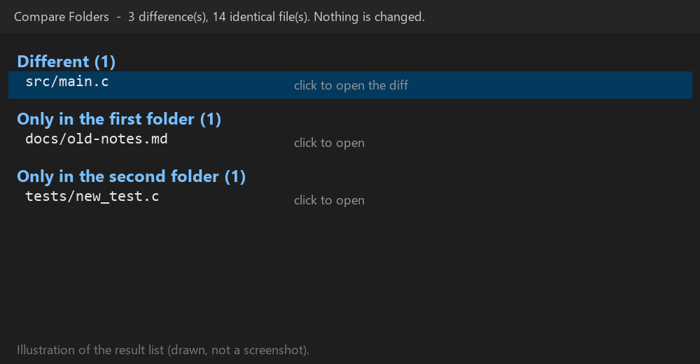

# Compare Folders

VS Code compares two files. This compares two whole folders.

## Use

1. Press `Ctrl+Shift+P` and run **Compare Folders: Compare Two Folders**.
2. Pick the first folder, then the second folder.
3. You get one list:
   - **Different**: same name, different content. Click one to open the diff.
   - **Only in the first folder** and **Only in the second folder**. Click one to open the file.
   - **Could not be read**: no permission, or the file is in use.
4. Identical files are only counted.

## How it decides

- Files with different sizes are different at once. Files with the same size are read byte by byte until the first difference.
- No dates, no hashes, no guessing. Same bytes means same.

## Safe by design

- Read only. Nothing is ever changed, copied or deleted.
- `.git` and `node_modules` are skipped. Symlinks are not followed.
- Everything runs on your machine. No network, no tracking.
